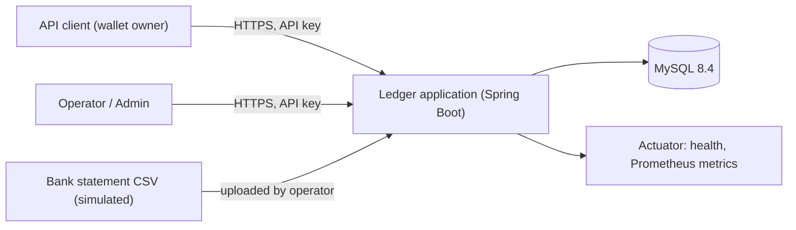
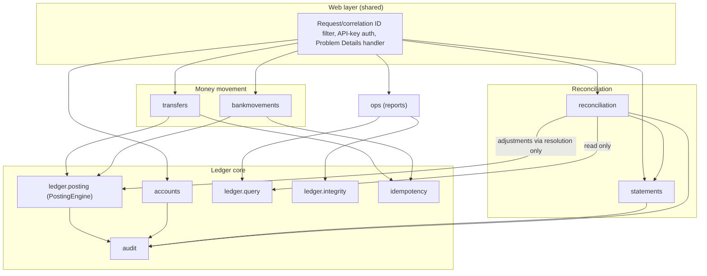

# 01 — Architecture

## Style

A **modular monolith**: one Spring Boot application, one MySQL schema, internal modules
with enforced boundaries. Rationale and alternatives: [ADR-0001](adr/0001-modular-monolith.md).

The single most important architectural property: **a financial operation is one local
database transaction** containing the idempotency record, the journal and its entries,
the balance updates, the business record (transfer/movement), and the audit event.

## System context



## Module view



## Component responsibilities

| Module | Owns | Must not |
|---|---|---|
| `shared` | `Money`, `CurrencyUnit`, prefixed public IDs, `Clock`, error model, web filters, security config | Contain business rules |
| `accounts` | Account lifecycle (create, freeze, unfreeze, close); chart of system accounts | Insert ledger entries |
| `ledger.posting` | `PostingEngine.post(JournalDraft, PostingContext)` — the **only** code path that inserts journals/entries and updates balance projections | Be reachable over HTTP directly |
| `ledger.query` | Balances, entry history (keyset pagination), journal lookup | Write anything |
| `ledger.integrity` | Integrity checks (journal balance, projection vs. entries, sequence gaps, trial balance) | Repair data automatically |
| `idempotency` | Key reservation, request hashing, response storage and replay | Use its own transaction |
| `transfers` | Transfer intent, validation, ownership, transfer status | Touch balances except via `PostingEngine` |
| `bankmovements` | Simulated deposits and payouts with external references | — |
| `statements` | Raw file storage, CSV parsing, mapping profiles, row validation, duplicate detection | Create financial effects |
| `reconciliation` | Runs, matching passes, discrepancy items, resolutions, reports | Modify ledger entries; it posts adjustments only through `PostingEngine` |
| `audit` | Appending audit events inside the caller's transaction | Be asynchronous (MVP) |
| `ops` | Failed-import and open-discrepancy reports, integrity-check endpoint | — |

Boundaries are verified by ArchUnit tests (e.g. only `ledger.posting` may write ledger
tables; `reconciliation` may not import `ledger.infrastructure`).

## Data flow: transfer

```mermaid
sequenceDiagram
    participant C as Client
    participant API as TransferController
    participant R as RetryingTransferService
    participant T as TransferService (@Transactional)
    participant DB as MySQL
    C->>API: POST /api/v1/transfers (Idempotency-Key)
    API->>API: authenticate, validate, normalize amount
    API->>R: CreateTransferCommand
    loop up to 3 attempts on deadlock / lock timeout
        R->>T: execute(command)
        T->>DB: BEGIN (READ COMMITTED)
        T->>DB: INSERT idempotency_records
        alt key already exists (error 1062)
            T->>DB: ROLLBACK
            R->>DB: SELECT stored record
            R-->>API: replay stored response or 422 key reused
        else new key
            T->>DB: SELECT account_balances FOR UPDATE (ascending account id)
            T->>T: check overdraft against locked balance
            T->>DB: INSERT journal + entries, UPDATE balances
            T->>DB: INSERT transfer, audit event; UPDATE idempotency response
            T->>DB: COMMIT
        end
    end
    API-->>C: 201 Created (or stored 422)
```

## Data flow: statement import and reconciliation

```mermaid
flowchart LR
    upload["POST statement-imports (multipart)"] --> storeFile["Store raw file + SHA-256 (txn 1)"]
    storeFile --> dupFile{"Same file hash for this bank account?"}
    dupFile -->|yes| conflict["409 DUPLICATE_IMPORT with existing batch id"]
    dupFile -->|no| parse["Parse rows in chunks (idempotent per row number)"]
    parse --> rows["statement_rows: VALID / INVALID / DUPLICATE / POSSIBLE_DUPLICATE"]
    rows --> batchDone["Batch COMPLETED or COMPLETED_WITH_ERRORS"]
    batchDone --> runStart["POST reconciliation-runs"]
    runStart --> load["Load canonical valid rows + cash-account ledger entries"]
    load --> passes["Deterministic matching passes"]
    passes --> items["reconciliation_items (immutable)"]
    items --> report["Report + balance proof"]
    items --> resolve["Operator resolutions (audited)"]
    resolve -->|"POST_ADJUSTMENT only"| posting["PostingEngine"]
```



## Cross-cutting concerns

- **Transactions:** service-layer `@Transactional` methods; retry wrappers live in a
  *separate* bean so they run outside the transaction proxy.
- **Errors:** RFC 9457 Problem Details with a stable `code` field.
- **Request tracing:** `X-Request-Id` (per HTTP request) and `X-Correlation-Id` (per
  business flow) are accepted or generated, placed in MDC, echoed in responses, and stored
  on journals and audit events.
- **Time:** an injected `Clock` (UTC) everywhere; no `LocalDateTime.now()` in domain code.
- **Security:** API keys hashed at rest; role checks at the controller/service boundary;
  ownership checks on account-scoped reads and writes.

## Proposed repository layout

```text
ledger/
├── pom.xml
├── Dockerfile
├── docker-compose.yml
├── .env.example
├── README.md
├── docker/mysql/init/01-users.sql          # migration user + restricted runtime user
├── docs/                                   # this documentation
├── samples/statements/                     # sample CSVs, incl. seeded discrepancies
├── perf/k6/                                # load-test scripts (Phase 11)
├── .github/workflows/ci.yml
└── src/
    ├── main/java/<base-package>/
    │   ├── LedgerApplication.java
    │   ├── shared/{money,id,time,error,web,security}
    │   ├── accounts/{api,application,domain,infrastructure}
    │   ├── ledger/{posting,query,integrity,domain,infrastructure}
    │   ├── idempotency/
    │   ├── transfers/{api,application,domain,infrastructure}
    │   ├── bankmovements/
    │   ├── statements/{api,parsing,application,infrastructure}
    │   ├── reconciliation/{api,matching,application,infrastructure}
    │   ├── audit/
    │   └── ops/
    ├── main/resources/
    │   ├── application.yml
    │   └── db/migration/V<n>__<description>.sql
    └── test/java/<base-package>/
        ├── ... unit tests (*Test)
        ├── ... integration tests (*IT)
        ├── concurrency/
        └── architecture/
```

`<base-package>` is an open question (see [14](14-decisions-and-open-questions.md)).

Within each module: `api` (controllers, DTOs), `application` (use-case services,
transactions), `domain` (pure Java, no Spring), `infrastructure` (JDBC repositories).
The `domain` packages must not depend on Spring or JDBC — enforced by ArchUnit.
