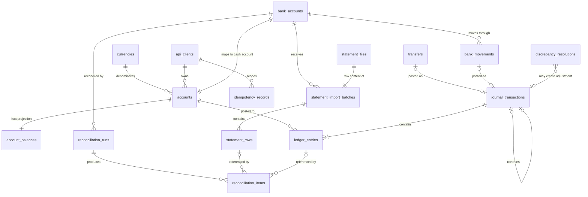

# 03 — Database Schema (proposal)

These snippets are **design proposals**, not migrations. Final DDL lands in Flyway
migrations during Phases 3–10 and must keep this document in sync.

## Conventions

| Concern | Convention | Reason |
|---|---|---|
| Primary keys | `BIGINT AUTO_INCREMENT` internal IDs | Compact clustered index; deterministic lock ordering |
| Public IDs | Prefixed ULIDs (`acct_…`, `jtx_…`, `trf_…`, `imp_…`, `rcn_…`), `CHAR(30)`, unique | No enumeration; sortable; readable in logs |
| Money | `DECIMAL(19,4)` | Exact; see [ADR-0004](adr/0004-money-representation.md) |
| Instants | `DATETIME(6)` stored in UTC | `TIMESTAMP` overflows in 2038; JDBC configured with `connectionTimeZone=UTC` |
| Business dates | `DATE` | Accounting/value dates are calendar dates |
| Enums | MySQL `ENUM` for small, stable sets | Rejects unknown values under strict mode |
| JSON | `JSON` for error lists, report details, stored responses | Flexible but never used for money columns |
| FK actions | `ON DELETE RESTRICT ON UPDATE RESTRICT` | No cascading deletes of financial history |
| SQL mode | Server default `STRICT_TRANS_TABLES` (asserted by a test) | Invalid data errors instead of silently truncating |
| Charset | `utf8mb4`, `utf8mb4_0900_ai_ci`; identifiers/references `ascii_bin` where exact match matters | Correct text handling; exact reference matching |

## Entity relationship diagram



## Table catalogue

| Table | Purpose | Mutability |
|---|---|---|
| `currencies` | Supported ISO 4217 codes and minor units | Seed/reference data |
| `api_clients` | API key holders, roles | `status`, `roles` mutable |
| `accounts` | Chart of accounts and wallets | `name`, `status` mutable; `type`, `currency`, `normal_balance` immutable |
| `account_balances` | Balance projection + lock point | Updated only by `PostingEngine` |
| `journal_transactions` | Posted journal headers | **Append-only** |
| `ledger_entries` | Debit/credit lines | **Append-only** |
| `idempotency_records` | Request dedup + response replay | Row completed within its creating txn; purged after expiry |
| `transfers` | Transfer intent and outcome | `status` (`POSTED → REVERSED`) |
| `bank_accounts` | External bank account ↔ cash ledger account | Metadata |
| `bank_movements` | Simulated deposits/payouts with external references | `status` (extension: `POSTED → SETTLED`) |
| `statement_files` | Raw uploaded bytes + hash | **Append-only** |
| `statement_import_batches` | One upload attempt | `status`, counters until terminal |
| `statement_rows` | One row per CSV data line | Immutable after batch reaches a terminal status |
| `reconciliation_runs` | One reconciliation execution | `status`, summary until terminal |
| `reconciliation_items` | Classified results | **Append-only** |
| `discrepancy_resolutions` | Human decisions on discrepancies | **Append-only** |
| `audit_events` | Who did what, when, why | **Append-only** |

## Core ledger DDL

```sql
-- Implemented in Phase 1 (V1__create_currencies.sql); seeded EUR 2, INR 2, JPY 0, KWD 3, USD 2.
CREATE TABLE currencies (
  code        CHAR(3)  CHARACTER SET ascii COLLATE ascii_bin NOT NULL PRIMARY KEY,
  minor_units TINYINT  NOT NULL,
  active      BOOLEAN  NOT NULL DEFAULT TRUE,
  CONSTRAINT ck_currencies_code CHECK (code REGEXP '^[A-Z]{3}$'),
  CONSTRAINT ck_currencies_minor_units CHECK (minor_units BETWEEN 0 AND 4)
);

CREATE TABLE accounts (
  id               BIGINT       NOT NULL AUTO_INCREMENT PRIMARY KEY,
  public_id        CHAR(30)     CHARACTER SET ascii NOT NULL,
  owner_client_id  BIGINT       NULL,                        -- NULL for system accounts
  system_code      VARCHAR(64)  CHARACTER SET ascii NULL,    -- e.g. ASSET.BANK.OPERATING
  name             VARCHAR(128) NOT NULL,
  type             ENUM('ASSET','LIABILITY','EQUITY','REVENUE','EXPENSE') NOT NULL,
  normal_balance   ENUM('DEBIT','CREDIT') NOT NULL,
  currency         CHAR(3)      CHARACTER SET ascii NOT NULL,
  overdraft_policy ENUM('FORBIDDEN','LIMITED','UNLIMITED') NOT NULL,
  overdraft_limit  DECIMAL(19,4) NULL,
  status           ENUM('ACTIVE','FROZEN','CLOSED') NOT NULL DEFAULT 'ACTIVE',
  created_at       DATETIME(6)  NOT NULL,
  updated_at       DATETIME(6)  NOT NULL,
  UNIQUE KEY uk_accounts_public_id (public_id),
  UNIQUE KEY uk_accounts_system_code_currency (system_code, currency),
  UNIQUE KEY uk_accounts_id_currency (id, currency),          -- composite FK target
  KEY idx_accounts_owner (owner_client_id),
  CONSTRAINT fk_accounts_currency FOREIGN KEY (currency) REFERENCES currencies (code),
  CONSTRAINT fk_accounts_owner FOREIGN KEY (owner_client_id) REFERENCES api_clients (id),
  CONSTRAINT ck_accounts_normal_balance CHECK (
       (type IN ('ASSET','EXPENSE')               AND normal_balance = 'DEBIT')
    OR (type IN ('LIABILITY','EQUITY','REVENUE')  AND normal_balance = 'CREDIT')),
  CONSTRAINT ck_accounts_overdraft CHECK (
       (overdraft_policy = 'LIMITED' AND overdraft_limit IS NOT NULL AND overdraft_limit > 0)
    OR (overdraft_policy <> 'LIMITED' AND overdraft_limit IS NULL))
);
-- Status transitions: ACTIVE <-> FROZEN; ACTIVE|FROZEN -> CLOSED only at zero balance.

CREATE TABLE account_balances (
  account_id     BIGINT        NOT NULL PRIMARY KEY,
  currency       CHAR(3)       CHARACTER SET ascii NOT NULL,
  balance        DECIMAL(19,4) NOT NULL DEFAULT 0,   -- normal-balance orientation
  min_balance    DECIMAL(19,4) NULL,                 -- 0 = no overdraft, -limit, NULL = unlimited
  last_entry_seq BIGINT        NOT NULL DEFAULT 0,
  updated_at     DATETIME(6)   NOT NULL,
  CONSTRAINT fk_balances_account FOREIGN KEY (account_id, currency)
      REFERENCES accounts (id, currency),
  CONSTRAINT ck_balances_floor CHECK (min_balance IS NULL OR balance >= min_balance)
);
-- Created in the same transaction as the account. Updated only by PostingEngine
-- (and by account overdraft-policy changes, which also lock this row).

CREATE TABLE journal_transactions (
  id                  BIGINT        NOT NULL AUTO_INCREMENT PRIMARY KEY,
  public_id           CHAR(30)      CHARACTER SET ascii NOT NULL,
  type                ENUM('TRANSFER','DEPOSIT','PAYOUT','REVERSAL','ADJUSTMENT','OPENING') NOT NULL,
  currency            CHAR(3)       CHARACTER SET ascii NOT NULL,
  total_debit         DECIMAL(19,4) NOT NULL,
  total_credit        DECIMAL(19,4) NOT NULL,
  reverses_journal_id BIGINT        NULL,
  external_reference  VARCHAR(64)   CHARACTER SET ascii COLLATE ascii_bin NULL,
  description         VARCHAR(255)  NULL,
  reason              VARCHAR(500)  NULL,          -- required for REVERSAL / ADJUSTMENT
  effective_date      DATE          NOT NULL,
  posted_at           DATETIME(6)   NOT NULL,
  posted_by           VARCHAR(64)   NOT NULL,      -- actor id
  request_id          VARCHAR(64)   NULL,
  correlation_id      VARCHAR(64)   NULL,
  UNIQUE KEY uk_jtx_public_id (public_id),
  UNIQUE KEY uk_jtx_reverses (reverses_journal_id),          -- reversed at most once
  UNIQUE KEY uk_jtx_id_currency (id, currency),
  KEY idx_jtx_external_reference (external_reference),
  KEY idx_jtx_effective_date (effective_date, id),
  KEY idx_jtx_correlation (correlation_id),
  CONSTRAINT fk_jtx_currency FOREIGN KEY (currency) REFERENCES currencies (code),
  CONSTRAINT fk_jtx_reverses FOREIGN KEY (reverses_journal_id) REFERENCES journal_transactions (id),
  CONSTRAINT ck_jtx_balanced CHECK (total_debit = total_credit AND total_debit > 0),
  CONSTRAINT ck_jtx_reversal_link CHECK ((type = 'REVERSAL') = (reverses_journal_id IS NOT NULL)),
  CONSTRAINT ck_jtx_reason CHECK (type NOT IN ('REVERSAL','ADJUSTMENT') OR reason IS NOT NULL)
);

CREATE TABLE ledger_entries (
  id             BIGINT        NOT NULL AUTO_INCREMENT PRIMARY KEY,
  journal_id     BIGINT        NOT NULL,
  line_no        SMALLINT      NOT NULL,
  account_id     BIGINT        NOT NULL,
  currency       CHAR(3)       CHARACTER SET ascii NOT NULL,
  direction      ENUM('DEBIT','CREDIT') NOT NULL,
  amount         DECIMAL(19,4) NOT NULL,
  account_seq    BIGINT        NOT NULL,     -- 1,2,3… per account, gapless
  balance_after  DECIMAL(19,4) NOT NULL,     -- account balance after this entry
  effective_date DATE          NOT NULL,
  posted_at      DATETIME(6)   NOT NULL,
  UNIQUE KEY uk_entries_line (journal_id, line_no),
  UNIQUE KEY uk_entries_account_seq (account_id, account_seq),
  KEY idx_entries_account_date (account_id, effective_date, account_seq),
  CONSTRAINT ck_entries_amount_positive CHECK (amount > 0),
  CONSTRAINT fk_entries_journal FOREIGN KEY (journal_id, currency)
      REFERENCES journal_transactions (id, currency),
  CONSTRAINT fk_entries_account FOREIGN KEY (account_id, currency)
      REFERENCES accounts (id, currency)
);

-- Repeated for journal_transactions, audit_events, statement_files,
-- reconciliation_items, discrepancy_resolutions.
CREATE TRIGGER trg_entries_no_update BEFORE UPDATE ON ledger_entries FOR EACH ROW
  SIGNAL SQLSTATE '45000' SET MESSAGE_TEXT = 'ledger_entries is append-only';
CREATE TRIGGER trg_entries_no_delete BEFORE DELETE ON ledger_entries FOR EACH ROW
  SIGNAL SQLSTATE '45000' SET MESSAGE_TEXT = 'ledger_entries is append-only';
```

### What the composite keys buy us

- `fk_entries_account (account_id, currency)` → an entry's currency **must** equal its
  account's currency.
- `fk_entries_journal (journal_id, currency)` → an entry's currency **must** equal its
  journal's currency.
- Together: a journal cannot mix currencies, enforced by the database.

### What `account_seq` and `balance_after` buy us

- `uk_entries_account_seq` makes a lost update or double application of the same balance
  state a **constraint violation** rather than silent corruption: two transactions that
  somehow both computed `seq = 42` cannot both commit.
- Point-in-time balance = `balance_after` of the last entry on or before a date — O(log n)
  via `idx_entries_account_date`, no full `SUM`.
- Integrity: the checker verifies the chain `balance_after(n) = balance_after(n−1) ± amount(n)`.

## Enforcing "the journal balances" across rows

A `CHECK` constraint sees **one row**. MySQL has no deferred constraints and no
statement-level triggers. A row-level `AFTER INSERT` trigger on `ledger_entries` would see a
temporarily unbalanced journal after the first line and cannot know when the last line has
arrived. So balance across rows is enforced in layers:

1. **Domain:** `JournalDraft` cannot be constructed unbalanced (see [02](02-accounting-model.md)).
2. **Header CHECK:** `ck_jtx_balanced` — the header's stored totals must be equal and positive.
3. **Single transaction:** header and all entries are inserted in the same transaction; any
   failure rolls back everything.
4. **Single writer:** only `PostingEngine` can insert entries (ArchUnit + grants review).
5. **Detective control:** the integrity checker proves entries match their header:

```sql
-- Journals whose entries do not match their header totals or have < 2 lines
SELECT j.id
FROM journal_transactions j
LEFT JOIN ledger_entries e ON e.journal_id = j.id
GROUP BY j.id, j.total_debit, j.total_credit
HAVING COUNT(e.id) < 2
    OR COALESCE(SUM(CASE WHEN e.direction = 'DEBIT'  THEN e.amount END), 0) <> j.total_debit
    OR COALESCE(SUM(CASE WHEN e.direction = 'CREDIT' THEN e.amount END), 0) <> j.total_credit;

-- Projection drift: account_balances vs. entries
SELECT b.account_id
FROM account_balances b
JOIN accounts a ON a.id = b.account_id
LEFT JOIN ledger_entries e ON e.account_id = b.account_id
GROUP BY b.account_id, b.balance, a.normal_balance
HAVING b.balance <> COALESCE(SUM(
         CASE WHEN e.direction = a.normal_balance THEN e.amount ELSE -e.amount END), 0);

-- Global trial balance per currency must be zero
SELECT currency,
       SUM(CASE WHEN direction = 'DEBIT' THEN amount ELSE -amount END) AS net
FROM ledger_entries
GROUP BY currency
HAVING net <> 0;
```

A stored-procedure-only posting API (app user may only `EXECUTE` a procedure that inserts
and validates) would move layer 4 into the database. It is a valid hardening extension;
we start with application posting for testability and readability.

## Idempotency and business records

```sql
CREATE TABLE idempotency_records (
  id              BIGINT       NOT NULL AUTO_INCREMENT PRIMARY KEY,
  client_id       BIGINT       NOT NULL,
  operation       VARCHAR(32)  CHARACTER SET ascii NOT NULL,  -- CREATE_TRANSFER, REVERSE_JOURNAL, …
  idempotency_key VARCHAR(128) CHARACTER SET ascii COLLATE ascii_bin NOT NULL,
  request_hash    BINARY(32)   NOT NULL,
  response_status SMALLINT     NULL,       -- NULL only inside the creating transaction
  response_body   JSON         NULL,
  resource_id     CHAR(30)     CHARACTER SET ascii NULL,
  created_at      DATETIME(6)  NOT NULL,
  expires_at      DATETIME(6)  NOT NULL,
  UNIQUE KEY uk_idem_scope (client_id, operation, idempotency_key),
  KEY idx_idem_expires (expires_at),
  CONSTRAINT fk_idem_client FOREIGN KEY (client_id) REFERENCES api_clients (id)
);

CREATE TABLE transfers (
  id                     BIGINT        NOT NULL AUTO_INCREMENT PRIMARY KEY,
  public_id              CHAR(30)      CHARACTER SET ascii NOT NULL,
  client_id              BIGINT        NOT NULL,
  idempotency_key        VARCHAR(128)  CHARACTER SET ascii COLLATE ascii_bin NOT NULL,
  source_account_id      BIGINT        NOT NULL,
  destination_account_id BIGINT        NOT NULL,
  currency               CHAR(3)       CHARACTER SET ascii NOT NULL,
  amount                 DECIMAL(19,4) NOT NULL,
  status                 ENUM('POSTED','REJECTED','REVERSED') NOT NULL,
  rejection_code         VARCHAR(40)   NULL,
  journal_id             BIGINT        NULL,
  reversal_journal_id    BIGINT        NULL,
  client_reference       VARCHAR(64)   NULL,
  description            VARCHAR(255)  NULL,
  created_at             DATETIME(6)   NOT NULL,
  updated_at             DATETIME(6)   NOT NULL,
  UNIQUE KEY uk_transfers_public_id (public_id),
  UNIQUE KEY uk_transfers_client_key (client_id, idempotency_key),   -- permanent dedup
  UNIQUE KEY uk_transfers_journal (journal_id),
  KEY idx_transfers_client_created (client_id, created_at, id),
  KEY idx_transfers_client_reference (client_id, client_reference),
  CONSTRAINT ck_transfers_distinct CHECK (source_account_id <> destination_account_id),
  CONSTRAINT ck_transfers_amount CHECK (amount > 0),
  CONSTRAINT ck_transfers_status CHECK (
       (status = 'POSTED'   AND journal_id IS NOT NULL AND rejection_code IS NULL AND reversal_journal_id IS NULL)
    OR (status = 'REJECTED' AND journal_id IS NULL     AND rejection_code IS NOT NULL)
    OR (status = 'REVERSED' AND journal_id IS NOT NULL AND reversal_journal_id IS NOT NULL)),
  CONSTRAINT fk_transfers_journal FOREIGN KEY (journal_id) REFERENCES journal_transactions (id),
  CONSTRAINT fk_transfers_reversal FOREIGN KEY (reversal_journal_id) REFERENCES journal_transactions (id)
);
-- Status transitions: (new) -> POSTED | REJECTED ; POSTED -> REVERSED. Nothing else.
```

`bank_accounts` and `bank_movements`:

| Column highlights | Constraints |
|---|---|
| `bank_accounts`: `public_id`, `bank_name`, `account_number_masked`, `currency`, `ledger_account_id` | `UNIQUE(ledger_account_id)`; FK `(ledger_account_id, currency)` → `accounts(id, currency)` |
| `bank_movements`: `public_id`, `type ENUM('DEPOSIT','PAYOUT')`, `bank_account_id`, `wallet_account_id`, `amount DECIMAL(19,4)`, `currency`, `external_reference`, `value_date`, `status`, `journal_id` | `UNIQUE(bank_account_id, external_reference)`; `UNIQUE(journal_id)`; `CHECK(amount > 0)` |

## Statement ingestion

```sql
CREATE TABLE statement_files (
  id           BIGINT     NOT NULL AUTO_INCREMENT PRIMARY KEY,
  sha256       BINARY(32) NOT NULL,
  size_bytes   INT        NOT NULL,
  content_type VARCHAR(100) NOT NULL,
  content      LONGBLOB   NOT NULL,          -- ≤ 10 MB enforced by the app
  uploaded_at  DATETIME(6) NOT NULL,
  CONSTRAINT ck_files_size CHECK (size_bytes > 0 AND size_bytes <= 10485760)
);

CREATE TABLE statement_import_batches (
  id                BIGINT       NOT NULL AUTO_INCREMENT PRIMARY KEY,
  public_id         CHAR(30)     CHARACTER SET ascii NOT NULL,
  bank_account_id   BIGINT       NOT NULL,
  file_id           BIGINT       NOT NULL,
  file_sha256       BINARY(32)   NOT NULL,
  original_filename VARCHAR(255) NOT NULL,
  mapping_profile   VARCHAR(64)  NOT NULL,
  status            ENUM('RECEIVED','PARSING','COMPLETED','COMPLETED_WITH_ERRORS','REJECTED') NOT NULL,
  rejection_reason  VARCHAR(500) NULL,
  period_start      DATE NULL,
  period_end        DATE NULL,
  opening_balance   DECIMAL(19,4) NULL,
  closing_balance   DECIMAL(19,4) NULL,
  balance_check     ENUM('NOT_PROVIDED','PASSED','FAILED') NOT NULL DEFAULT 'NOT_PROVIDED',
  total_rows        INT NOT NULL DEFAULT 0,
  valid_rows        INT NOT NULL DEFAULT 0,
  invalid_rows      INT NOT NULL DEFAULT 0,
  duplicate_rows    INT NOT NULL DEFAULT 0,
  uploaded_by       VARCHAR(64) NOT NULL,
  created_at        DATETIME(6) NOT NULL,
  completed_at      DATETIME(6) NULL,
  UNIQUE KEY uk_batches_public_id (public_id),
  UNIQUE KEY uk_batches_file (bank_account_id, file_sha256),   -- duplicate file import
  KEY idx_batches_status (status, created_at),
  CONSTRAINT fk_batches_bank_account FOREIGN KEY (bank_account_id) REFERENCES bank_accounts (id),
  CONSTRAINT fk_batches_file FOREIGN KEY (file_id) REFERENCES statement_files (id)
);
-- Transitions: RECEIVED -> PARSING -> COMPLETED | COMPLETED_WITH_ERRORS ; RECEIVED|PARSING -> REJECTED.

CREATE TABLE statement_rows (
  id                  BIGINT       NOT NULL AUTO_INCREMENT PRIMARY KEY,
  batch_id            BIGINT       NOT NULL,
  bank_account_id     BIGINT       NOT NULL,          -- denormalized for the dedup index
  line_number         INT          NOT NULL,          -- 1-based data row number (ROW_NUMBER is reserved in MySQL 8)
  raw_line            TEXT         NOT NULL,
  parse_status        ENUM('VALID','INVALID','DUPLICATE','POSSIBLE_DUPLICATE') NOT NULL,
  errors              JSON         NULL,              -- [{field, code, message}]
  bank_txn_id         VARCHAR(64)  CHARACTER SET ascii COLLATE ascii_bin NULL,
  value_date          DATE         NULL,
  booking_date        DATE         NULL,
  direction           ENUM('CREDIT','DEBIT') NULL,    -- bank's perspective
  amount              DECIMAL(19,4) NULL,
  currency            CHAR(3)      CHARACTER SET ascii NULL,
  reference           VARCHAR(64)  CHARACTER SET ascii COLLATE ascii_bin NULL,  -- normalized
  description         VARCHAR(255) NULL,
  running_balance     DECIMAL(19,4) NULL,
  fingerprint         BINARY(32)   NULL,              -- hash of normalized fields
  dedup_key           VARCHAR(64)  CHARACTER SET ascii COLLATE ascii_bin NULL,  -- = bank_txn_id for the canonical row only
  duplicate_of_row_id BIGINT       NULL,
  created_at          DATETIME(6)  NOT NULL,
  UNIQUE KEY uk_rows_batch_line (batch_id, line_number),         -- idempotent re-parse
  UNIQUE KEY uk_rows_dedup (bank_account_id, dedup_key),         -- NULLs allowed many times
  KEY idx_rows_match (bank_account_id, parse_status, value_date),
  KEY idx_rows_reference (bank_account_id, reference),
  KEY idx_rows_fingerprint (bank_account_id, fingerprint),
  CONSTRAINT fk_rows_batch FOREIGN KEY (batch_id) REFERENCES statement_import_batches (id),
  CONSTRAINT fk_rows_duplicate FOREIGN KEY (duplicate_of_row_id) REFERENCES statement_rows (id),
  CONSTRAINT ck_rows_valid_fields CHECK (
       parse_status = 'INVALID'
    OR (value_date IS NOT NULL AND direction IS NOT NULL AND amount > 0 AND currency IS NOT NULL))
);
```

MySQL has no partial unique indexes; the **nullable `dedup_key`** pattern emulates one:
only the canonical (first-seen) row carries the key, duplicates store `NULL` and point at
the canonical row via `duplicate_of_row_id`.

## Reconciliation

```sql
CREATE TABLE reconciliation_runs (
  id                  BIGINT      NOT NULL AUTO_INCREMENT PRIMARY KEY,
  public_id           CHAR(30)    CHARACTER SET ascii NOT NULL,
  bank_account_id     BIGINT      NOT NULL,
  period_start        DATE        NOT NULL,
  period_end          DATE        NOT NULL,
  date_tolerance_days TINYINT     NOT NULL,
  rules_version       VARCHAR(16) NOT NULL,
  input_fingerprint   BINARY(32)  NULL,       -- hash of sorted input row/entry ids
  status              ENUM('RUNNING','COMPLETED','FAILED') NOT NULL,
  active_lock         BIGINT      NULL,       -- = bank_account_id while RUNNING, else NULL
  summary             JSON        NULL,
  failure_reason      VARCHAR(500) NULL,
  started_by          VARCHAR(64) NOT NULL,
  started_at          DATETIME(6) NOT NULL,
  heartbeat_at        DATETIME(6) NOT NULL,
  completed_at        DATETIME(6) NULL,
  UNIQUE KEY uk_runs_public_id (public_id),
  UNIQUE KEY uk_runs_active (active_lock),              -- one RUNNING run per bank account
  KEY idx_runs_account_period (bank_account_id, period_start, period_end),
  CONSTRAINT ck_runs_period CHECK (period_end >= period_start),
  CONSTRAINT ck_runs_lock CHECK ((status = 'RUNNING') = (active_lock IS NOT NULL))
);
-- Transitions: RUNNING -> COMPLETED | FAILED.

CREATE TABLE reconciliation_items (
  id                 BIGINT NOT NULL AUTO_INCREMENT PRIMARY KEY,
  run_id             BIGINT NOT NULL,
  category           ENUM('MATCHED','MATCHED_TIMING_DIFFERENCE','SUGGESTED_MATCH',
                          'AMOUNT_MISMATCH','CURRENCY_MISMATCH','DIRECTION_MISMATCH',
                          'MISSING_IN_STATEMENT','PENDING_IN_TRANSIT','MISSING_IN_LEDGER',
                          'DUPLICATE_EXTERNAL','POSSIBLE_DUPLICATE','AMBIGUOUS','RESOLVED') NOT NULL,
  match_method       ENUM('REFERENCE','HEURISTIC','MANUAL_LINK','NONE') NOT NULL,
  statement_row_id   BIGINT NULL,
  ledger_entry_id    BIGINT NULL,
  candidate_group    INT    NULL,          -- groups AMBIGUOUS candidates
  amount_difference  DECIMAL(19,4) NULL,   -- statement minus ledger
  date_difference    INT    NULL,          -- days
  requires_action    BOOLEAN NOT NULL,
  details            JSON   NULL,
  KEY idx_items_run_category (run_id, category),
  KEY idx_items_statement_row (statement_row_id),
  KEY idx_items_ledger_entry (ledger_entry_id),
  CONSTRAINT fk_items_run FOREIGN KEY (run_id) REFERENCES reconciliation_runs (id),
  CONSTRAINT fk_items_row FOREIGN KEY (statement_row_id) REFERENCES statement_rows (id),
  CONSTRAINT fk_items_entry FOREIGN KEY (ledger_entry_id) REFERENCES ledger_entries (id),
  CONSTRAINT ck_items_subject CHECK (statement_row_id IS NOT NULL OR ledger_entry_id IS NOT NULL)
);

CREATE TABLE discrepancy_resolutions (
  id                      BIGINT NOT NULL AUTO_INCREMENT PRIMARY KEY,
  public_id               CHAR(30) CHARACTER SET ascii NOT NULL,
  subject_type            ENUM('STATEMENT_ROW','LEDGER_ENTRY') NOT NULL,
  subject_id              BIGINT NOT NULL,
  origin_item_id          BIGINT NOT NULL,           -- the item the operator acted on
  action                  ENUM('LINK_MANUALLY','CONFIRM_SUGGESTED','POST_ADJUSTMENT',
                               'ACCEPT_TIMING_DIFFERENCE','MARK_BANK_ERROR','IGNORE_DUPLICATE') NOT NULL,
  reason                  VARCHAR(1000) NOT NULL,
  linked_statement_row_id BIGINT NULL,
  linked_ledger_entry_id  BIGINT NULL,
  adjustment_journal_id   BIGINT NULL,
  resolved_by             VARCHAR(64) NOT NULL,
  resolved_at             DATETIME(6) NOT NULL,
  UNIQUE KEY uk_resolutions_public_id (public_id),
  UNIQUE KEY uk_resolutions_subject (subject_type, subject_id),   -- one final decision per subject
  UNIQUE KEY uk_resolutions_linked_entry (linked_ledger_entry_id), -- an entry links to at most one row
  CONSTRAINT fk_resolutions_item FOREIGN KEY (origin_item_id) REFERENCES reconciliation_items (id),
  CONSTRAINT fk_resolutions_adjustment FOREIGN KEY (adjustment_journal_id) REFERENCES journal_transactions (id)
);

CREATE TABLE audit_events (
  id             BIGINT NOT NULL AUTO_INCREMENT PRIMARY KEY,
  occurred_at    DATETIME(6) NOT NULL,
  actor_type     ENUM('CLIENT','OPERATOR','ADMIN','SYSTEM') NOT NULL,
  actor_id       VARCHAR(64) NOT NULL,
  action         VARCHAR(64) NOT NULL,   -- JOURNAL_POSTED, TRANSFER_REJECTED, ACCOUNT_FROZEN, …
  entity_type    VARCHAR(32) NOT NULL,
  entity_id      CHAR(30) CHARACTER SET ascii NOT NULL,
  request_id     VARCHAR(64) NULL,
  correlation_id VARCHAR(64) NULL,
  payload        JSON NULL,              -- no secrets; amounts allowed; account numbers masked
  KEY idx_audit_entity (entity_type, entity_id, occurred_at),
  KEY idx_audit_time (occurred_at),
  KEY idx_audit_correlation (correlation_id)
);
```

## Grants (local and CI)

```sql
-- Migration user: owns DDL (used only by Flyway)
GRANT ALL PRIVILEGES ON ledger.* TO 'ledger_migrator'@'%';

-- Runtime user: least privilege
GRANT SELECT, INSERT ON ledger.journal_transactions    TO 'ledger_app'@'%';
GRANT SELECT, INSERT ON ledger.ledger_entries          TO 'ledger_app'@'%';
GRANT SELECT, INSERT ON ledger.audit_events            TO 'ledger_app'@'%';
GRANT SELECT, INSERT ON ledger.statement_files         TO 'ledger_app'@'%';
GRANT SELECT, INSERT ON ledger.reconciliation_items    TO 'ledger_app'@'%';
GRANT SELECT, INSERT ON ledger.discrepancy_resolutions TO 'ledger_app'@'%';
GRANT SELECT, INSERT, UPDATE ON ledger.account_balances, ledger.accounts, ledger.transfers,
      ledger.bank_movements, ledger.statement_import_batches, ledger.reconciliation_runs
      TO 'ledger_app'@'%';   -- written as separate statements in the real script
GRANT SELECT, INSERT ON ledger.statement_rows TO 'ledger_app'@'%';
GRANT SELECT, INSERT, UPDATE, DELETE ON ledger.idempotency_records TO 'ledger_app'@'%';  -- purge job
```

## Locking, isolation, transaction boundaries

| Operation | Transaction boundary | Locks (in order) |
|---|---|---|
| Create account | Insert account + balance row + audit | None beyond inserted rows |
| Freeze/close account | Update account status + audit | Balance row `FOR UPDATE` |
| Transfer / deposit / payout | Idempotency + post + business row + audit | Idempotency unique key → balance rows ascending |
| Reversal | Idempotency + reversal journal + transfer status + audit | Idempotency key → original transfer row `FOR UPDATE` → balance rows ascending |
| Statement import | Txn 1: file + batch (`RECEIVED`). Txn per chunk of ~1,000 rows. Final txn: counters + terminal status | Batch row `FOR UPDATE` per chunk (single worker per batch) |
| Reconciliation run | Txn 1: insert run with `active_lock`. Compute in memory. Txn 2: insert all items + summary + `COMPLETED` | Unique `active_lock` prevents concurrent runs |
| Resolution | Idempotency + resolution + optional adjustment journal + audit | Idempotency key → (adjustment) balance rows ascending |

Isolation: READ COMMITTED for all application transactions
([ADR-0005](adr/0005-locking-and-isolation.md)). Deadlock and retry handling:
[06](06-concurrency-and-failure-modes.md).

## Index rationale (to validate with `EXPLAIN ANALYZE` in Phase 11)

| Query | Index |
|---|---|
| Account history, newest first, keyset by `account_seq` | `uk_entries_account_seq (account_id, account_seq)` |
| Balance as of date | `idx_entries_account_date (account_id, effective_date, account_seq)` |
| Reconciliation: cash-account entries in a date window | `idx_entries_account_date` |
| Reconciliation: lookup by external reference | `idx_jtx_external_reference` |
| Statement rows eligible for matching | `idx_rows_match (bank_account_id, parse_status, value_date)` |
| Transfer history per client | `idx_transfers_client_created` |
| Open discrepancy report | `idx_items_run_category` on the latest completed run per bank account |
