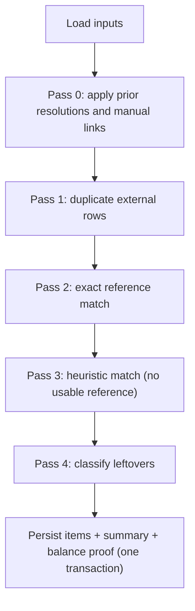
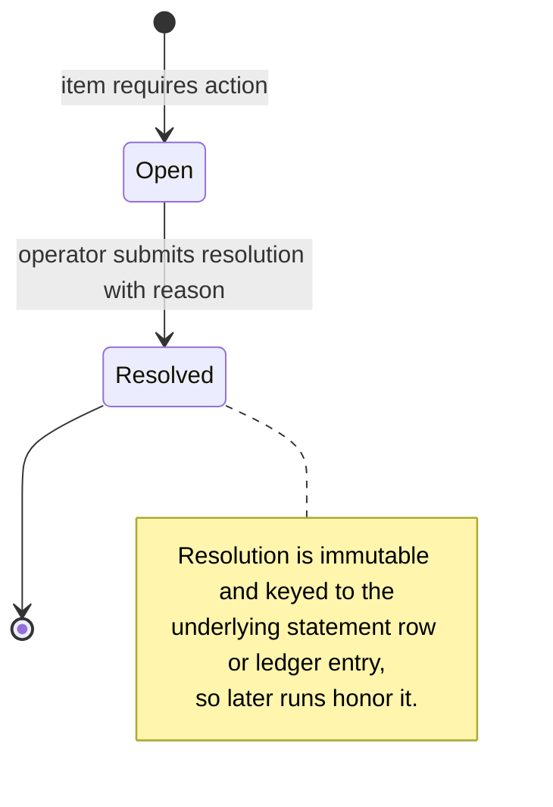

# 07 — Reconciliation

## Purpose

Compare what the **bank says happened** (statement rows) with what the **ledger says
happened** (entries on the bank's mapped cash account), classify every difference, and
require an auditable human decision for anything that is not a clean match.

Reconciliation **never modifies ledger entries**. The only way it can cause a financial
effect is an ADMIN `POST_ADJUSTMENT` resolution, which posts a *new* journal through
`PostingEngine` with a reason, idempotency, and an audit event.

## Inputs of a run

| Side | Selection |
|---|---|
| Statement | `statement_rows` for the bank account with `parse_status IN ('VALID','DUPLICATE','POSSIBLE_DUPLICATE')`, from batches in `COMPLETED`/`COMPLETED_WITH_ERRORS`, `value_date` within `[periodStart, periodEnd]` |
| Ledger | `ledger_entries` on the mapped cash account with `effective_date` within `[periodStart − tolerance, periodEnd + tolerance]`, joined to the journal's `external_reference` and type |
| Prior decisions | `discrepancy_resolutions` for any subject in scope |
| Parameters | `dateToleranceDays` (default 2), `rulesVersion` (`v1`) |

`input_fingerprint` = SHA-256 over sorted (row ids, entry ids, resolution ids, parameters),
so we can prove two runs saw the same inputs.

## Authoritative fields

| Field | Authority | Notes |
|---|---|---|
| Amount actually moved, value date, bank transaction ID | **Bank** | The bank statement is the evidence of cash movement |
| Customer allocation, purpose, internal reference | **Ledger** | The bank does not know which wallet a deposit belongs to |
| Matching key | `statement.reference` ↔ `journal.external_reference` | References are normalized: trim, uppercase, strip internal whitespace |

Neither side automatically "wins": a mismatch is a discrepancy to resolve, not a value to
overwrite.

## Normalization

- Statement `CREDIT` ↔ ledger `DEBIT` on the cash (asset) account; statement `DEBIT` ↔
  ledger `CREDIT` (see [02](02-accounting-model.md)).
- Amounts compared with `BigDecimal.compareTo` at the currency scale.
- Dates compared as calendar days: `date_difference = statement.value_date − entry.effective_date`.

## Deterministic matching passes (rules v1)

Each pass consumes the subjects it classifies; later passes see only what remains.
Inputs are sorted by stable keys (`value_date, id` / `effective_date, id`) so results are
reproducible, but **no tie is ever broken by ordering** — ties become `AMBIGUOUS`.



**Pass 0 — prior decisions.** Subjects with a resolution become `RESOLVED` (or `MATCHED`
with `match_method = MANUAL_LINK` for `LINK_MANUALLY`/`CONFIRM_SUGGESTED`). They are
excluded from later passes.

**Pass 1 — duplicates.** Rows imported as `DUPLICATE` → `DUPLICATE_EXTERNAL` (excluded from
matching, counted). Rows imported as `POSSIBLE_DUPLICATE` → `POSSIBLE_DUPLICATE`
(`requires_action`), excluded from matching until resolved.

**Pass 2 — reference match.** Group remaining rows and entries by normalized reference.

| Rows with this reference | Entries with this reference | Outcome |
|---|---|---|
| 1 | 1 | Compare fields (below) |
| 1 | more than 1 | `AMBIGUOUS` (all candidates share a `candidate_group`) |
| more than 1 | 1 or more | `AMBIGUOUS` (all candidates share a `candidate_group`) |
| 1 or more | 0 | Rows continue to Pass 3 |
| 0 | 1 or more | Entries continue to Pass 3 |

Field comparison for a 1:1 reference pair, in order:

1. Currency differs → `CURRENCY_MISMATCH`
2. Direction inconsistent → `DIRECTION_MISMATCH`
3. Amount differs → `AMOUNT_MISMATCH` (record `amount_difference`)
4. `|date_difference| ≤ tolerance` → `MATCHED`
5. Otherwise → `MATCHED_TIMING_DIFFERENCE` (`requires_action = true`)

**Pass 3 — heuristic match** for rows without a reference or whose reference found no entry,
against entries not yet matched:

- Candidate if same currency, consistent direction, equal amount, `|date_difference| ≤ tolerance`.
- If the row has exactly one candidate **and** that entry has exactly one candidate row
  (mutual uniqueness) → `SUGGESTED_MATCH` (`requires_action = true`; not counted as matched
  until confirmed).
- If more than one candidate on either side → `AMBIGUOUS`.

**Pass 4 — leftovers.**

| Leftover | Condition | Category | Requires action |
|---|---|---|---|
| Ledger entry | `effective_date > periodEnd − tolerance` | `PENDING_IN_TRANSIT` | No (expected to appear on next statement) |
| Ledger entry | otherwise | `MISSING_IN_STATEMENT` | Yes |
| Statement row | — | `MISSING_IN_LEDGER` | Yes |

Ledger entries outside `[periodStart, periodEnd]` that were pulled in only by the tolerance
window and did not match are **not** reported (they belong to adjacent periods).

## Discrepancy taxonomy

| Category | Typical real-world cause | Is it necessarily an error? | Allowed resolutions |
|---|---|---|---|
| `MATCHED` | Normal | No | — |
| `MATCHED_TIMING_DIFFERENCE` | Weekend/holiday settlement, slow rails | Usually no | `ACCEPT_TIMING_DIFFERENCE` |
| `SUGGESTED_MATCH` | Bank dropped/truncated reference | No | `CONFIRM_SUGGESTED`, `LINK_MANUALLY` (to another entry) |
| `AMOUNT_MISMATCH` | Bank deducted a fee from the transfer, partial settlement, keying error | Maybe | `POST_ADJUSTMENT` (fee difference), `MARK_BANK_ERROR` |
| `CURRENCY_MISMATCH` | Wrong bank account mapping, provider error | Likely | `MARK_BANK_ERROR` (investigate) |
| `DIRECTION_MISMATCH` | Sign convention bug, bank reversal | Likely | `MARK_BANK_ERROR`, investigate |
| `MISSING_IN_STATEMENT` | Payout failed at bank, posting error | Maybe | Investigate → reversal via the ledger API (separate workflow), `ACCEPT_TIMING_DIFFERENCE` |
| `PENDING_IN_TRANSIT` | Initiated near period end | No | None needed |
| `MISSING_IN_LEDGER` | Bank fee, interest, unidentified deposit | Maybe | `POST_ADJUSTMENT` (fee → Bank Charges; unknown deposit → Suspense), `LINK_MANUALLY`, `MARK_BANK_ERROR` |
| `DUPLICATE_EXTERNAL` | Overlapping statements | No | `IGNORE_DUPLICATE` (optional, for reporting) |
| `POSSIBLE_DUPLICATE` | Two identical rows without bank IDs | Unknown | `IGNORE_DUPLICATE`, `LINK_MANUALLY` |
| `AMBIGUOUS` | Several equal-amount transactions on the same day | Unknown | `LINK_MANUALLY` (pick the pair explicitly) |
| `RESOLVED` | Decision exists from earlier run | — | — |

## Matching vs settlement confirmation

A **match** asserts that a statement row and a ledger entry describe the same movement of
money. It does **not** assert that:

- the payout reached the correct beneficiary;
- the amount was the contractually correct amount (fees, FX, netting);
- the underlying obligation (e.g. an invoice) is settled.

Settlement confirmation is a separate business state transition (extension: payout
`POSTED → SETTLED`, moving funds from `Payouts Clearing` to `Cash at Bank`). It may *use*
a match as evidence, but it is an explicit, audited action — not a side effect of matching.

## Resolution workflow



Rules:

- Every resolution requires `reason` (≥ 10 chars) and an `Idempotency-Key`.
- `POST_ADJUSTMENT` requires ADMIN; posts a journal of type `ADJUSTMENT` with
  `external_reference = statement.bank_txn_id` (or reference), so the next run matches it
  by reference in Pass 2 rather than relying on the resolution.
- `LINK_MANUALLY` requires both subjects to be unresolved, same currency; amount and date
  differences are allowed but recorded.
- Reopening a resolution is an extension (would need a `superseded_by` chain).
- Each resolution writes an `audit_events` row: `DISCREPANCY_RESOLVED` with item, action,
  actor, reason, and any adjustment journal ID.
- Corrections to the ledger that are *not* bank-driven (e.g. reversing a failed payout) go
  through the normal reversal API — reconciliation only links to the outcome.

## Report

Per run:

- Counts and amount totals per category.
- `matchRateByCount = (MATCHED + MATCHED_TIMING_DIFFERENCE + MANUAL) / eligible statement rows`.
- `matchRateByValue` = same, weighted by amount.
- `requiresAction` count; age of oldest open item.
- **Balance proof** (classic bank reconciliation statement):

```text
  Ledger cash balance at period end
+ deposits in transit       (ledger debits not yet on statement)
− payouts in transit        (ledger credits not yet on statement)
+ unrecorded bank credits   (MISSING_IN_LEDGER, bank CREDIT)
− unrecorded bank debits    (MISSING_IN_LEDGER, bank DEBIT; e.g. fees)
= expected bank closing balance
  compared to statement closing balance → unexplained difference (should be 0)
```

A non-zero unexplained difference is itself a reported finding.

## Rerun semantics

- Runs are read-only with respect to the ledger and statement data.
- Rerunning with unchanged inputs yields identical items (asserted via `input_fingerprint`
  and an item-set comparison test).
- Each run is a snapshot; older runs remain queryable. "Current status" of a bank account =
  latest `COMPLETED` run.
- Only one `RUNNING` run per bank account (`uk_runs_active`).

## Out of scope (v1)

- One-to-many / many-to-one matching (one bank credit settling many payouts). The
  `candidate_group` column leaves room for group matches in rules v2.
- Fuzzy reference matching (edit distance). Deterministic exact rules first.
