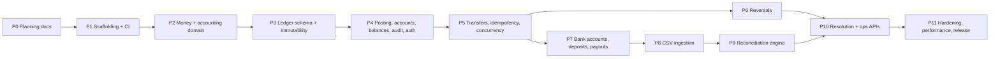

# 10 — Phased Implementation Roadmap

Phases are ordered by dependency. Each phase ends with green CI, updated docs, and a
short "what I learned" note in the PR description. Commits follow Conventional Commits.

Changes from the originally suggested order, and why:

- **CI and the integration-test harness move to Phase 1**, so every later phase is tested
  on MySQL from day one.
- **Concurrency tests ship with transfers (Phase 5)** instead of a late testing phase —
  correctness evidence must accompany the feature.
- **Bank movements (Phase 7) are a separate phase** before ingestion: reconciliation needs
  bank-facing ledger activity with external references to match against.
- The pure **money/accounting domain (Phase 2)** precedes the schema so rules are designed
  without SQL bias and tested in milliseconds.

---

## Phase 0 — Planning documentation ✅

- **Goal:** agreed blueprint in `docs/`.
- **Done:** all documents in [README](README.md) exist; open questions listed in [14](14-decisions-and-open-questions.md).
- **Commit checkpoint:** `docs: add planning documentation and ADRs` (made in Phase 1 after `git init`).

---

## Phase 1 — Project scaffolding, local infrastructure, CI (walking skeleton) ✅

Reviewed and committed as `feat: add phase 1 application foundation`.

Implementation notes:

- Runtime grants live in `src/main/resources/db/migration/R__runtime_grants.sql`, applied by
  the migration user (granted `WITH GRANT OPTION`). The app user receives no privileges in the
  Docker init script.
- The Docker init script is `docker/mysql/init/01-users.sh`, a shell script rather than SQL,
  because user names and passwords come from environment variables. Testcontainers mounts the
  same script.
- Strict SQL mode is pinned per application session (`connection-init-sql`) and also asserted
  for the server default.
- Commit `chore: initialize repository with planning docs` is done. Code commits wait for review.

- **Learn first:** Spring Boot 4 project structure and modular starters; Flyway versioned
  migrations; Testcontainers + `@ServiceConnection`; twelve-factor config; MySQL users and grants.
- **Prerequisites:** Phase 0 approved; open questions Q1 (base package) answered.
- **Database changes:** `V1__create_currencies.sql` (table + seed INR, USD, EUR, JPY, KWD).
  Docker init script creates `ledger_migrator` and `ledger_app` users.
- **API changes:** none beyond Actuator health/info.
- **Tasks (in order):**
  1. `git init`; `.gitignore` (target, IDE files, `.env`); commit the existing `docs/`.
  2. Verify versions per [ADR-0002](adr/0002-technology-stack-and-versions.md) gate (Initializr, `dependency:tree`).
  3. Maven project with wrapper; Java 21; Boot 4.1.x; dependencies: webmvc, validation, jdbc, flyway (+ `flyway-mysql`), actuator, mysql-connector-j, springdoc, test, testcontainers-mysql, archunit. (jqwik was planned here and removed in the Phase 1 review; see ADR-0002.)
  4. Surefire (`*Test`) and Failsafe (`*IT`) configuration; JaCoCo report.
  5. `docker-compose.yml`: `mysql:8.4` with healthcheck, `log_bin_trust_function_creators=1`, init script, named volume; `app` service (profile `app`) built later.
  6. `.env.example` with placeholder credentials; `application.yml` reading env vars; separate Flyway and runtime datasource credentials.
  7. Shared web plumbing: request/correlation ID filter (MDC + response headers), Problem Details handler with `code`, structured JSON console logging.
  8. Health: liveness/readiness groups including DB.
  9. Integration test base: shared MySQL container, Flyway runs as migrator, app uses restricted user.
  10. Tests: `ApplicationStartsIT`, `FlywayMigrationIT`, `StrictSqlModeIT`, `CorrelationIdFilterIT`, `ProblemDetailsIT`, first `ArchitectureTest` rules.
  11. GitHub Actions `ci.yml`: JDK 21 + Maven cache, `./mvnw -B verify`.
  12. Minimal `README.md` (quick start) following [12](12-readme-outline-and-demo.md).
- **Acceptance criteria:**
  - `./mvnw verify` passes locally from a clean clone (Docker running).
  - `docker compose up -d mysql` → healthy; app starts against it; Flyway applies V1 with no MySQL-version warning.
  - `GET /actuator/health/readiness` → `UP`.
  - Every response carries `X-Request-Id`; a 404 returns Problem Details JSON.
  - CI green on the first push.
  - No secrets committed (only `.env.example`).
- **Definition of done:** acceptance criteria met; ADR-0002 updated with the exact resolved versions.
- **Risks / likely mistakes:** using Boot 3 starter names or Testcontainers 1.x coordinates;
  Flyway trigger creation failing due to binlog settings (matters in Phase 3); running the
  app as root DB user and hiding grant bugs; Windows line endings in shell scripts used by
  the MySQL container (`.gitattributes` with `*.sh text eol=lf`).
- **Commit checkpoints:**
  `chore: initialize repository with planning docs` →
  `build: scaffold Spring Boot 4.1 Maven project` →
  `build: add docker compose MySQL 8.4 with restricted users` →
  `feat(shared): request ids, problem details, structured logging` →
  `test: testcontainers integration harness and flyway migration test` →
  `ci: add GitHub Actions verify workflow`.

---

## Phase 2 — Money and accounting domain (pure Java) — implemented with the internal parts of Phases 3 and 4 ✅

Scope decision (Phase 2 approval): Phase 2 was asked to deliver the accounting model, the
schema migrations, accounts, journals, entries, balanced posting, balances and the tests that
prove the invariants. That spans the original Phases 2, 3 and the internal half of 4, so they
were merged:

| Delivered in Phase 2 | Still in a later phase |
|---|---|
| Phase 2 as planned: `Money`, `CurrencyUnit`, `JournalDraft`, `mirror()`, seeded randomized tests | — |
| Phase 3: `accounts`, `account_balances`, `journal_transactions`, `ledger_entries`, `audit_events`, immutability triggers, runtime grants, system-account seed, constraint/immutability tests | `api_clients` and `accounts.owner_client_id` → Phase 4 (with authentication) |
| Phase 4 internals: `PostingEngine` (ordered locking, seq, `balance_after`, audit event), `AccountService.open`, `LedgerQueries` (balance, as-of balance, entries, journal), `IntegrityChecker`, single-writer ArchUnit rule, rollback test | All REST endpoints, authentication, account freeze/close, `POST/GET /ops/integrity-checks` and its scheduled job, `OPENING` journals via the API |
| — | Transfers, idempotency, reversal service, reconciliation (unchanged) |

Implementation notes:

- `PostingEngine` rejects `REVERSAL` drafts (`REVERSAL_NOT_SUPPORTED`): the schema and
  `JournalDraft.mirror()` support reversals, but the reversal service (locking the original,
  status transition) is Phase 6.
- Property tests are seeded JUnit tests (Q12, ADR-0002); `MoneyPropertiesTest`,
  `JournalPropertiesTest` and `LedgerModelPropertiesTest` run 1,000 seeded iterations each, and
  `RandomizedLedgerSimulationIT` replays seeded random postings against MySQL and an in-memory
  reference model.

Phase 2 review follow-ups (accepted, done): the integrity checker also reports entries whose
`effective_date` or `posted_at` differs from their journal header; `AccountOpeningRollbackIT`
proves account opening is atomic. Header-to-entry balancing and projection consistency are
documented as application-enforced invariants with detective checks
([03](03-database-schema.md), [05](05-invariants.md)). No post-write re-sum was added to
`PostingEngine`. Phase numbering is unchanged: Phase 3 is merged into Phase 2, and the next
milestone is Phase 4.

- **Learn first:** double-entry bookkeeping, normal balances, ISO 4217 minor units,
  `BigDecimal` scale vs precision, `compareTo` vs `equals`, property-based testing.
- **Prerequisites:** Phase 1.
- **Database/API changes:** none.
- **Tasks:** `CurrencyUnit` (code + minor units); `Money` (parse from string, normalize,
  arithmetic, comparisons); `AccountType`/`NormalBalance`/`Direction`; `JournalDraft` builder
  with all rules in [02](02-accounting-model.md); `JournalDraft.mirror()` for reversals;
  ArchUnit rule banning double-based `BigDecimal` construction.
- **Tests:** all "Money and domain" rows in [09](09-testing-strategy.md).
- **Acceptance:** 100 % branch coverage on `Money` and `JournalDraft`; properties pass with 1,000 tries.
- **Risks:** `new BigDecimal(0.1)`; `BigDecimal.equals` surprises; silently rounding user input.
- **Commits:** `feat(shared): Money and CurrencyUnit value objects` → `feat(ledger): journal draft validation` → `test(ledger): accounting property tests`.

---

## Phase 3 — Core ledger schema and immutability — merged into Phase 2

Delivered in Phase 2 except `api_clients` / `owner_client_id`, which move to Phase 4. Grants
live in `R__runtime_grants.sql`, not in the init script (Phase 1 decision). The original plan
is kept below for reference.

- **Learn first:** InnoDB clustered indexes, composite foreign keys, CHECK constraint
  limits, triggers and `SIGNAL`, least-privilege grants.
- **Prerequisites:** Phase 2.
- **Database changes:** `api_clients`, `accounts`, `account_balances`,
  `journal_transactions`, `ledger_entries`, `audit_events`; immutability triggers; grants
  in the init script; seed system accounts per currency.
- **Tests:** "Schema and migrations" rows in [09](09-testing-strategy.md).
- **Acceptance:** every constraint in [03](03-database-schema.md) for these tables has a test proving it rejects bad data.
- **Risks:** `ON DELETE CASCADE` slipping in; unsigned types; `TIMESTAMP` columns; forgetting the runtime user's grants on new tables.
- **Commits:** `feat(db): accounts and balances schema` → `feat(db): journal and entry schema with immutability triggers` → `feat(db): runtime grants` → `test(db): constraint and immutability tests`.

---

## Phase 4 — Posting engine, accounts API, balances, audit, authentication ✅

Implemented in local commits `0cd8794` through `a839cee` plus the docs commit, one tested
milestone each:
business dates in `Asia/Kolkata`; V6–V8 schema and grants; API-key authentication and client
management; transactional idempotency (pulled forward from Phase 5); account lifecycle under
the posting lock; the accounts API; journal lookup and ADMIN opening journals; recorded
integrity checks with the nightly job; role-matrix and end-to-end tests.

Decisions taken (D1–D8 from the Phase 4 plan):

- Idempotency is in Phase 4 for account creation, lifecycle changes and openings
  ([ADR-0006](adr/0006-idempotency-in-posting-transaction.md) implementation notes).
- Opening policy, role matrix and ownership as in [ADR-0009](adr/0009-authentication.md);
  the `UNLIMITED` restriction is an API-layer policy, `AccountService` stays permissive.
- Freeze is OPERATOR or ADMIN; unfreeze and close are ADMIN only; a reason is required.
- `OPENING` journals: ADMIN only, reason required (application-enforced), every non-system
  account must have no entries (checked under the lock), backdating allowed, future dates
  rejected.
- Entries are listed newest first, `limit` ≤ 200, opaque cursor, no entry ids.
- System accounts are unowned and ACTIVE (database CHECKs); new integrity check
  `CLOSED_ACCOUNT_NONZERO`.

Still open after Phase 4 (deliberately): the idempotency purge job and its `DELETE` grant;
a lock-retry wrapper (Phase 5); the integrity-check in-progress guard is per instance, not
cluster-wide; entry filters (`from`, `to`, `direction`, `journalType`) on the entries
endpoint; transfers, reversals, deposits and payouts.

Original plan, kept for reference:

After the Phase 2 merge, what remains here is: `api_clients` and `accounts.owner_client_id`,
API-key authentication and roles, the REST endpoints below over the existing services,
account freeze/unfreeze/close (with the column-level grants they need), the integrity-check
API and scheduled job, and `OPENING` journals. The posting engine, account opening, queries,
integrity checker and single-writer rule already exist.

Decisions carried over from the Phase 2 review (must be settled in this phase):

- **Business-date time zone (Q5).** `PostingEngine` rejects future effective dates using the
  UTC date. With the proposed `Asia/Kolkata` default, a posting dated "today" between 00:00
  and 05:30 IST would be rejected. Decide the zone, inject it as configuration, and use it
  for the future-date check and as-of balances; add a test at the day boundary.
- **Account-status locking.** Postings read `accounts.status` without a lock (only the
  balance row is `FOR UPDATE`). Freeze/unfreeze/close must lock the account's balance row
  (`SELECT … FOR UPDATE`) before changing the status, so a status change and a posting
  serialize. Grant column-level `UPDATE (status, updated_at)` on `accounts` only.
  `FrozenAccountRaceIT` (Phase 5) proves it.
- **Overdraft authorization.** `AccountService.open` accepts any type and overdraft policy,
  including `UNLIMITED`. The API must restrict this by role: clients open `FORBIDDEN`
  wallets only; `LIMITED` and non-wallet types are ADMIN-only; `UNLIMITED` stays reserved
  for system accounts.

- **Learn first:** Spring transaction proxies (self-invocation trap), `SELECT … FOR UPDATE`,
  keyset pagination, API-key hashing, Problem Details mapping.
- **Prerequisites:** Phase 3.
- **API changes:** `POST/GET /accounts`, `GET /accounts/{id}/balance`, `GET /accounts/{id}/entries`,
  freeze/unfreeze/close, `GET /journal-transactions/{id}`, `POST/GET /ops/integrity-checks`.
- **Tasks:** `PostingEngine` (lock ordering, seq, `balance_after`, audit); account service;
  query service; API-key auth filter and role checks; integrity checker + scheduled job;
  `OPENING` journal for seeding (ADMIN-only internal use); ArchUnit "single writer" rule.
- **Tests:** "Ledger posting", "Security and API" rows.
- **Acceptance:** rollback test proves atomicity; integrity checker clean after scenario; OpenAPI lists endpoints.
- **Risks:** `@Transactional` on private/self-invoked methods; offset pagination; leaking existence of other clients' accounts (use 404).
- **Commits:** `feat(ledger): posting engine with ordered locking` → `feat(accounts): account lifecycle API` → `feat(ledger): balance and entry queries` → `feat(security): API key authentication` → `feat(ledger): integrity checker`.

---

## Phase 5 — Transfers, idempotency, concurrency, overdraft prevention

- **Learn first:** lost updates; InnoDB locking reads vs snapshot reads; deadlocks and
  victim selection; idempotency keys (IETF draft, Stripe's design); retry with jitter.
- **Prerequisites:** Phase 4.
- **Database changes:** `idempotency_records`, `transfers`.
- **API changes:** `POST /transfers`, `GET /transfers/{id}`, `GET /transfers?…`.
- **Tasks:** request normalization + hashing; idempotency repository; `TransferService`
  (transactional) and `RetryingTransferService` (non-transactional wrapper); rejection
  persistence; replay header; purge job; metrics (`ledger.transfer.duration`,
  `ledger.idempotency.replays`, `ledger.lock.retries`).
- **Carried over from the Phase 2 review — deadlock retry.** `PostingEngine` has no retry;
  a deadlock or lock-wait timeout currently surfaces as an exception and rolls back. Retry
  belongs in the non-transactional `RetryingTransferService` around the whole transaction
  (bounded attempts, jittered backoff, MySQL 1213/1205 only), never inside it.
  `ConcurrentPostingIT` saw no deadlocks thanks to ascending lock order, but retry is still
  required for lock-wait timeouts and for locks taken by other statements.
- **Tests:** "Transfers, idempotency, concurrency" rows — including the 50-thread overspend test.
- **Acceptance:** all concurrency tests pass 20 consecutive times locally and in CI.
- **Risks:** retry inside the transaction; Hikari pool smaller than test threads; using a
  non-locking read anywhere in the check path; hashing raw JSON instead of the normalized command.
- **Commits:** `feat(idempotency): transactional idempotency records` → `feat(transfers): transfer API with overdraft protection` → `feat(transfers): deadlock retry wrapper` → `test(transfers): concurrency and idempotency suites`.

---

## Phase 6 — Reversals and corrections

- **Learn first:** reversal accounting; why history must be immutable; audit requirements.
- **Prerequisites:** Phase 5.
- **API changes:** `POST /journal-transactions/{id}/reversals`.
- **Tasks:** reversal service (lock original transfer row → balances), status transition
  `POSTED → REVERSED`, correlation for corrections, audit events.
- **Carried over from the Phase 2 review — reversals.** The schema (`uk_jtx_reverses`,
  composite `fk_jtx_reverses`, `ck_jtx_reversal_link`) and `JournalDraft.mirror()` exist, but
  `PostingEngine` rejects `REVERSAL` drafts with `REVERSAL_NOT_SUPPORTED`. This phase removes
  that guard behind the reversal service, which locks the original before posting; Q4
  (reversal when the recipient already spent the funds) must be answered first.
- **Tests:** "Reversals and audit" rows.
- **Acceptance:** concurrent reversal test yields exactly one reversal; original rows untouched (checksum before/after).
- **Commits:** `feat(ledger): journal reversal` → `test(ledger): reversal concurrency and audit`.

---

## Phase 7 — Bank accounts, deposits, payouts

- **Learn first:** clearing accounts; payment references (UTR/RRN); why internal transfers never hit the bank statement.
- **Prerequisites:** Phase 5 (Phase 6 not required).
- **Database changes:** `bank_accounts`, `bank_movements`.
- **API changes:** `POST /bank-accounts`, `POST /deposits`, `POST /payouts`.
- **Tests:** deposit increases cash and wallet; payout overdraft-protected; duplicate external reference → replay or 409; idempotency suite reused.
- **Commits:** `feat(bankmovements): bank account mapping` → `feat(bankmovements): simulated deposits and payouts`.

---

## Phase 8 — CSV statement ingestion

- **Learn first:** RFC 4180 edge cases; encodings and BOM; CSV injection; chunked, idempotent batch processing.
- **Prerequisites:** Phase 7.
- **Database changes:** `statement_files`, `statement_import_batches`, `statement_rows`.
- **API changes:** upload, batch status, row listing; `GET /ops/import-failures`.
- **Tasks:** mapping profiles; parser + validators; duplicate detection; balance check;
  recovery job; sample files in `samples/statements/`.
- **Tests:** "Statement ingestion" rows.
- **Acceptance:** for every fixture, `statement_rows` count equals data-line count; every error code exercised.
- **Risks:** rounding during parse; loading the whole file into memory repeatedly; dropping invalid rows; locale-dependent parsing.
- **Commits:** `feat(statements): file storage and batch lifecycle` → `feat(statements): CSV parsing and validation` → `feat(statements): duplicate detection` → `test(statements): malformed and duplicate imports`.

---

## Phase 9 — Reconciliation engine and reports

- **Learn first:** bank reconciliation statements; deterministic algorithms; precision/recall on labeled data.
- **Prerequisites:** Phase 8.
- **Database changes:** `reconciliation_runs`, `reconciliation_items`.
- **API changes:** start run, report, items, item detail.
- **Tasks:** matching passes as pure functions over in-memory inputs; persistence adapter;
  single-active-run guard; stale-run sweeper; report + balance proof; metrics `recon.items{category}`.
- **Tests:** "Reconciliation" rows; seeded dataset with expected category table.
- **Acceptance:** seeded dataset classified 100 % as expected; rerun identical; ledger untouched.
- **Commits:** `feat(reconciliation): matching passes` → `feat(reconciliation): runs and persistence` → `feat(reconciliation): report and balance proof`.

---

## Phase 10 — Discrepancy resolution and operational APIs

- **Learn first:** separation of duties; maker-checker; audit evidence.
- **Prerequisites:** Phases 6 and 9.
- **Database changes:** `discrepancy_resolutions`.
- **API changes:** resolutions endpoint; `GET /ops/discrepancies`.
- **Tasks:** action/category validation matrix; ADMIN-gated adjustments through `PostingEngine`;
  resolutions honored by Pass 0; ops reports; gauge `recon.open_discrepancies`.
- **Tests:** "Resolution and ops" rows.
- **Acceptance:** resolve → rerun shows `RESOLVED`/`MATCHED`; every resolution has a reason and audit event.
- **Commits:** `feat(reconciliation): auditable resolutions` → `feat(ops): discrepancy and import reports`.

---

## Phase 11 — Hardening, performance, observability, release

- **Learn first:** `EXPLAIN ANALYZE`; latency percentiles; coordinated omission; load-test design; container hardening.
- **Prerequisites:** Phase 10.
- **Tasks:** crash/restart tests (F1–F3, F7, F9); data generator (1M and 10M entries);
  k6 scenarios (uniform transfers, hot account, balance reads, 100k-row import);
  record results with hardware specs in `docs/benchmarks.md`; optional
  `observability` Compose profile (Prometheus + one Grafana dashboard); multi-stage
  Dockerfile (non-root, JRE only) or Jib; Gitleaks + Dependabot in CI; demo script; full README.
- **Acceptance:** benchmarks documented with methodology; demo runs end-to-end from a clean clone; all invariant tests green.
- **Commits:** `test: crash and recovery scenarios` → `perf: load tests and benchmark report` → `build: container image` → `docs: README and demo`.

---

## Extensions backlog (post-MVP)

| Extension | Depends on | Key design note |
|---|---|---|
| Holds / available balance | P5 | Holds lock the same balance row; capture = journal + hold update in one txn |
| Payout clearing + settlement confirmation | P7, P9 | Matching provides evidence; settlement is an explicit transition |
| Maker-checker for adjustments/reversals | P10 | Pending approval record; different approver required |
| Cross-currency transfers | P5 | Two balanced journals + FX position accounts ([ADR-0007](adr/0007-single-currency-journals.md)) |
| One-to-many reconciliation | P9 | Subset-sum is NP-hard; restrict to reference-grouped batches |
| Outbox + Kafka | P5 | Outbox row in posting txn; relay publishes after commit |
| Audit hash chain | P4 | `prev_hash` per event; verification job |
| OpenTelemetry tracing | P11 | Trace IDs alongside correlation IDs |
| Partitioning/archival | P11 | Range partitioning by `effective_date`; requires PK change |
